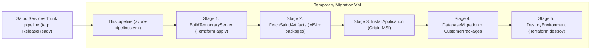

 # 🚀 104.104 Origin Migration Pipeline (P2)

This repo contains the **automated migration pipeline** for the **Origin** application (Titanium Solutions dental web services) for the **104.104 release**.

In simple terms:

- 🏗️ Spin up a **temporary Azure VM** using Terraform
- 📦 Install the new **Origin MSI** and configuration packages
- 🗄️ Run the **database migration** and **install customer packages** on that VM
- 🧹 Tear the temporary VM **down again**

All of this is orchestrated from **Azure DevOps** using [azure-pipelines.yml](azure-pipelines.yml).

---

## 🧭 High‑Level Flow

The pipeline is triggered by the upstream **Salud Services Trunk** pipeline whenever a build is tagged **`ReleaseReady`**.

Here is the overall flow as a diagram (rendered by GitHub / DevOps when Mermaid is enabled):



Key ideas:

- The **migration work** and **package install** happen on a **short‑lived VM** created just for this run.
- After migration and package upload, that VM is **destroyed automatically** (even if earlier steps fail).

---

## 📁 Repository Overview

```text
main.tf              # Terraform: temporary Azure VM and related resources
variables.tf         # Terraform: variable declarations
terraform.tfvars     # Non‑sensitive default values for variables
azure-pipelines.yml  # Azure DevOps pipeline definition

scripts/             # PowerShell used during the migration run on the temp VM
  Copy-Artifacts.ps1           # Copy MSI + ZIP artifacts into C:\Build
  Install-Origin.ps1           # Install Origin MSI (full configuration)
  Uninstall-Origin.ps1         # Clean uninstall of existing Origin
  Configure-IIS.ps1            # IIS configuration after install
  Stop-IIS.ps1                 # Stop IIS before deployment
  Start-IIS.ps1                # Start IIS after migration
  Run-DatabaseMigration.ps1    # Run migration EXE and capture logs
  NewMigration-Message.ps1     # Surface migration log messages back to Azure DevOps
  Create-UploadWebServices.ps1 # Configure web service URL for package upload
  Run-UploadPackages.ps1       # Upload and install customer packages
```

---

## 🧱 Pipeline Stages (Simple View)

The main stages defined in [azure-pipelines.yml](azure-pipelines.yml) are:

1. **BuildTemporaryServer** (agent: SQL-Agent)  
   - Installs Terraform.
   - Uses [main.tf](main.tf) to create a **temporary Windows VM** in Azure from the `104-migration-image`.
  - Registers this VM as an Azure DevOps build agent (`Origin-123-Agent`).

2. **FetchSaludArtifacts** (agent: Origin-123-Agent)  
   - Downloads `Setup_Origin.msi` and `CustomerPackages.zip` from the upstream pipeline.
   - Copies both to `C:\Build\` and extracts the customer packages.

3. **InstallApplication** (agent: Origin-123-Agent)  
   - Stops IIS.
   - Uninstalls any existing Origin instance.
   - Installs the new MSI with all required features and connection details (DB server, DB name, credentials, IIS site, app pool, etc.).
   - Configures IIS (site + app pool) after install.

4. **DatabaseMigration** (agent: Origin-123-Agent)  
   - Runs `Titanium.Migration.DataAccess.Migration.exe` with `-autorun` and `-audittables` against the target database.
   - Logs are written to `C:\Build\DataMigrationLog.txt` (split stdout/stderr then merged).
   - If there are warnings (`SucceededWithIssues`), a summary is added to the Azure DevOps build using `NewMigration-Message.ps1`.
  - IIS is started again at the end.
  - Configures upload web services and installs **customer packages** using `Create-UploadWebServices.ps1` and `Run-UploadPackages.ps1` on the same temporary VM.

5. **DestroyEnvironment** (agent: SQL-Agent, condition: `always()`)  
   - Re‑runs `terraform init` with the same backend.
   - Executes `terraform destroy -auto-approve` to delete **all** temporary resources.
   - Because this runs even if earlier stages fail, you avoid orphaned resources and unnecessary cost. 💸

If the DatabaseMigration stage (including package upload) passes, you can be confident the migration is valid from installer → DB → IIS → API → packages on the temporary VM. ✅

---

## 🌩️ Terraform Infrastructure (main.tf)

Terraform builds and tears down a **small, short‑lived Windows VM** used only for migration:

- `azurerm_resource_group` – temporary RG tagged with `AutoDelete = true` and a 1‑hour expiration.
- `azurerm_public_ip` – static public IP so the VM can register as an agent.
- `azurerm_network_interface` + NSG association – connects the VM to the existing `main-subnet` and `main-nsg` in `test_terraform_rgroup`.
- `azurerm_windows_virtual_machine` – `Standard_B2s` VM built from the `104-migration-image` custom image.
- `azurerm_virtual_machine_extension` – runs `setup.ps1` from Azure Blob Storage to self‑register the VM as an Azure DevOps agent.

State is stored remotely in:

- Resource group: **tfstate-rg**  
- Storage account: **tfstateorigin123**  
- Container: **tfstate**  
- Key: **origin-123.tfstate**

A `random_id` suffix is added to resource names to avoid collisions across runs.

---

## 🔐 Secrets and Variable Groups

No secrets are stored in this repo. Everything sensitive comes from Azure DevOps **variable groups** used in [azure-pipelines.yml](azure-pipelines.yml):

| Variable Group      | Purpose / Example Values |
|---------------------|--------------------------|
| `104 MigrationTest` | Database server and name (`privateDB`, `databaseName`), SQL credentials (`databaseUser`, `databasePassword`), subscription info (`SubscriptionId`), VM admin credentials (`admin_username`, `admin_password`), clinic key (`ClinicKey`), VM admin password for the image (`ADMIN_PASSWORD`), and storage access (`STORAGE_ACCOUNT_NAME`, `STORAGE_ACCOUNT_KEY`). |
| `TERRAFORM`         | Service principal used by Terraform (`CLIENT_ID`, `CLIENT_SECRET`, `SUBSCRIPTION_ID`, `TENANT_ID`). |

Keep these variable groups up to date and scoped correctly in Azure DevOps; the pipeline assumes they already exist.

---

## ✅ Prerequisites (Before You Run It)

To successfully run this pipeline, you need:

- An **Azure DevOps project** with access to the **Dublin** agent pool.
- A self‑hosted build agent called **SQL-Agent** (Terraform CLI is installed during the run).
- Shared Azure infrastructure in resource group **test_terraform_rgroup**:
  - Virtual network: `main-vnet`
  - Subnet: `main-subnet`
  - Network security group: `main-nsg`
  - Generalised image: `104-migration-image`
- Terraform backend resources:
  - Storage account `tfstateorigin123`
  - Container `tfstate` (for state)
  - Container `test` with `setup.ps1` uploaded (used by the VM extension)
- The `104 MigrationTest` and `TERRAFORM` variable groups configured with the correct values and linked to this pipeline.

Once these are in place, you can queue the pipeline against a build of **Salud Services Trunk** that is tagged **ReleaseReady** and let the automation do the rest. 🎉
